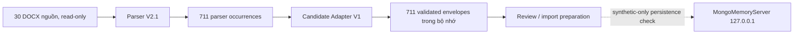

# Parser → Adapter Integration

## Acceptance evidence

- 30/30 files được đối chiếu SHA-256 và package validation.
- 711/711 occurrences khớp source order và locator; missing 0, extra 0, parser issues 0.
- Folder counts: Easy Start 243, Must-Know Vocabulary 294, Essential Collocation 174.
- 30 source files vẫn là 30 Chapter candidates; 3 source folders vẫn là 3 Tag candidates.
- 711/711 envelope có `sourceIdentity` riêng, qua `validateVocabularyCandidateEnvelope`, giữ parser order và không có Mongo `_id`.
- Source fields, display metadata, paragraph/table locators, word/POS, senses, bilingual examples, notes, raw values, duplicate metadata, review reasons/issues và normalized source path được so sánh với parser result.
- Mỗi envelope vẫn `NEEDS_REVIEW`; `publicationEligible=false`.

90 independent expanded goldens được so sánh trên 14 field mỗi entry: 1.254 `EXACT_MATCH`, 6 `AMBIGUOUS_SOURCE`, không có missing, normalization-only, incorrect mapping hay extra content. 90/90 file hashes khớp và cả 90 candidate tiếp tục `NEEDS_REVIEW`. Bộ comparator hỗ trợ `expected.notes` ở dạng string hoặc object để khớp schema của evidence hiện có.

711 candidate chỉ tồn tại trong bộ nhớ trong dry-run. Không ghi chúng vào app database hoặc đưa text từ nguồn vào Git.
