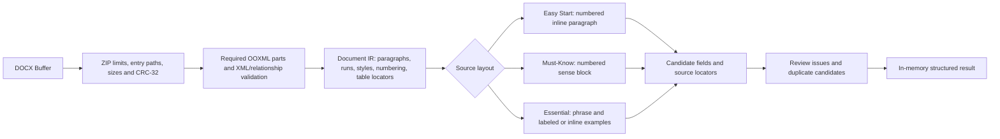

# Vocabulary DOCX Parser V2 architecture

**Status:** Independent parser module; not connected to an Import API or persistence layer.

**Parser version:** `2.0.0`.

## Pipeline

## Package and resource boundary

- `yauzl` reads archive entries incrementally. The parser checks duplicate/unsafe entry paths, supported compression, declared and streamed sizes, CRC-32, required parts, XML well-formedness and internal relationship targets.
- Defaults cap input at 20 MiB, any archive entry at 16 MiB, an XML part at 8 MiB, total uncompressed data at 64 MiB, archive entries at 2,000, and compression ratio at 1,000:1. Limits can be overridden for isolated tests.
- DTD/entity declarations are rejected. External package relationships are recorded and surfaced as review warnings; they are never fetched.
- SHA-256 is computed from the exact input buffer. A caller-provided hash is checked when supplied.

## Intermediate representation

The OOXML pass preserves source paragraph order, paragraph index, run order, text, line breaks, bold/italic/color/highlight/underline/style/font size, paragraph style, Word numbering metadata and table/row/cell coordinates. Raw source text and parsed candidates are separate; normalization does not overwrite source meaning. Each candidate carries filename, source folder/path, hash, parser version, source ordinal, display number, topic/chapter candidates and paragraph range.

## Layout strategies

| Source | Entry boundary | Field mapping |
|---|---|---|
| TOEIC EASY START | Word-numbered paragraph with inline headword/POS/meaning | Explicit Word line breaks delimit the source meaning and example lines; later lines are paired in source order. Color is retained as evidence and is not the only delimiter. |
| TOEIC MUST-KNOW VOCABULARY | Literal numbered headword paragraph through the next entry/day boundary | POS subsections become senses; meaning paragraphs remain raw; arrows split bilingual examples; usage text after examples remains notes. `sourceOrdinal` is independent from `sourceDisplayNumber`. |
| TOEIC ESSENTIAL COLLOCATION | Unnumbered phrase/meaning paragraph | Supports labeled following-paragraph examples and inline three-line rows; POS is optional. The filename `Chaper 10.docx` is preserved as supplied. |

Table paragraphs are retained with table coordinates. A table is surfaced for review because none of the 30 verified originals contains a table from which this layout strategy could be validated.

## Result contract

`DocxVocabularyParserV2.parseDocxBuffer(buffer, sourceMetadata, options)` returns `{ parserVersion, source, items, summary, warnings }`. `parseDocxFiles([{ buffer, source }])` adds cross-file duplicate candidates while keeping all source occurrences. Candidates contain raw and normalized fields, POS/senses/examples/notes, `reviewStatus`, issues and locators. No MongoDB IDs, model status, database clients, API handlers or publication behavior are present.
