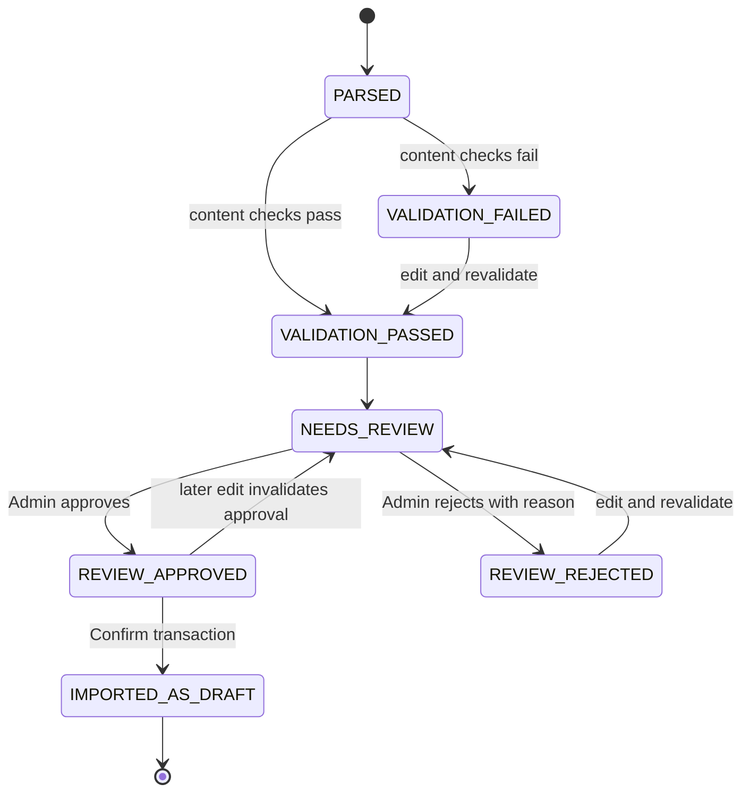

# Phase V3A — Editorial review workflow

## Trạng thái độc lập

Parse, machine validation, editorial review, draft import và publication là các facet khác nhau. Parse/validation không tự approve Candidate; approve cũng không làm Candidate eligible để publish.

`parseStatus=PARSED`, validation status, review status, import status và publication status được lưu riêng. API thêm `status` tổng hợp cho UI nhưng không thay thế các facet.

## Edit và validation

Admin có thể sửa word, POS, senses/meanings, bilingual examples và notes. Mọi edit:

1. Yêu cầu `expectedVersion` khớp candidate `__v`.
2. Chỉ nhận trường đã allowlist, gồm allowlist lồng nhau cho sense/example.
3. Chuẩn hóa Unicode NFC, giới hạn độ dài/số lượng và từ chối markup HTML, control chars.
4. Revalidate toàn bộ effective values.
5. Đưa review về `NEEDS_REVIEW`, xóa quyết định approve/reject cũ và khóa publication.
6. Ghi changed field before/after, actor, thời gian và edit reason trong cùng transaction với Candidate/Batch.

Nếu hai editor cùng dùng version cũ, chỉ một write có thể thành công; request còn lại nhận `409 CONCURRENT_MODIFICATION`. Nếu audit write thất bại, transaction hủy cả edit.

## Editorial decision

- `APPROVE`: chỉ cho phép khi `validationStatus=VALIDATION_PASSED`.
- `REJECT`: cần reason; candidate giữ nguyên raw/parsed source và vẫn có thể được sửa rồi review lại.
- Duplicate/source revision: cần `duplicateDecision=KEEP_SEPARATE` trước approval. V3A không hỗ trợ reuse Vocabulary.
- `REVIEW_APPROVED` không đồng nghĩa Published hoặc publication eligible.

Review audit ghi actor ID, thời điểm, decision, duplicate decision và reason. Raw source không bị sửa bởi quyết định review.

## Confirm Draft

Confirm chỉ tạo Draft từ candidate valid + `REVIEW_APPROVED`. Các bước tạo Tag, Chapter, Catalog Vocabulary, ChapterVocabulary membership, Candidate import refs, audit và Batch counts/version nằm trong cùng transaction. Retry trả các IDs đã tạo. Confirm đồng thời trên cùng Batch/Candidate đã được kiểm tra trên MongoMemoryReplSet; chỉ một Vocabulary/Membership/Confirm audit được tạo cho mỗi source identity.

Tag và Chapter refs được lưu theo từng source file trong Batch, nên một batch nhiều DOCX vẫn giữ mapping Chapter. Tất cả Tag/Chapter/Vocabulary được tạo mới đều ở Draft/hidden; không có Publish transition trong router này.
