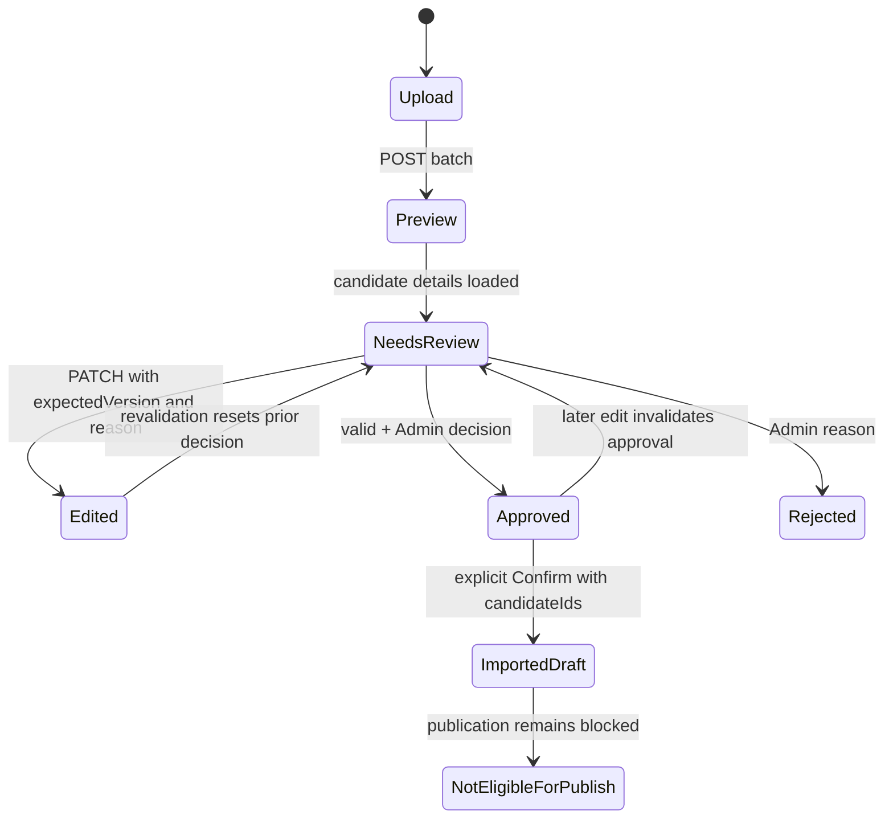

# Phase V3B — Review and Confirm workflow

## Trạng thái

Validation, editorial decision, import state và publication state được hiển thị độc lập. `VALIDATION_PASSED` không chuyển thành `REVIEW_APPROVED`; Approve không tạo nội dung đã publish.

## Candidate edit và conflict

1. Source DOCX text, source metadata và parser values là read-only.
2. Reviewer sửa form state, nhập edit reason và gửi duy nhất field changes nằm trong V3A allowlist.
3. V3A revalidate và ghi audit. Nếu update thành công sau một approval/rejection, UI nhận `NEEDS_REVIEW` và yêu cầu quyết định lại. Duplicate choice cũng được xóa để Admin xác nhận lại.
4. `409 CONCURRENT_MODIFICATION` giữ nguyên form local. Khung conflict đối chiếu word, số nghĩa/ví dụ/notes và bản máy chủ; details cho phép xem parsed server values. Nút tải bản máy chủ là hành động rõ ràng, không có ghi đè âm thầm.

## Editorial decision

- Approve chỉ bật khi `validationStatus=VALIDATION_PASSED`, form không dirty, và candidate chưa imported.
- Reject cần reason; API lưu actor, decision, reason và thời điểm trong audit timeline.
- Nếu duplicate/source revision/catalog match được annotate, UI chỉ cung cấp `KEEP_SEPARATE`. Không xuất hiện `REUSE_EXISTING`.
- Sau khi Confirm, candidate editor chỉ đọc; UI hiển thị Vocabulary/Chapter IDs.

## Confirm Draft

1. Admin chọn từng candidate đã `REVIEW_APPROVED` + `VALIDATION_PASSED`; các candidate khác hoặc đã imported bị khóa chọn.
2. Panel đối soát hiển thị số đã chọn, approved, cần review, rejected, imported và duplicate occurrence cần giữ riêng.
3. Dialog nói rõ: **“Thao tác này tạo Vocabulary Draft, chưa xuất bản cho học viên.”**
4. API nhận `{ expectedVersion, candidateIds }`. Response `results`, `rowErrors`, IDs và batch status được hiển thị.
5. Lỗi mạng/timeout đánh dấu kết quả chưa xác định, khóa Confirm và yêu cầu tải lại batch trước khi chọn lại. UI không tự retry payload.

V3A Confirm dùng transaction trên replica set và retry candidate đã nhập trả lại refs cũ. Browser harness đã kiểm tra một Confirm thành công và một response bị ngắt trong mock: trường hợp mock này khóa retry cho tới khi batch được tải lại. Real isolated backend test kiểm tra Confirm thành công với synthetic candidate.
