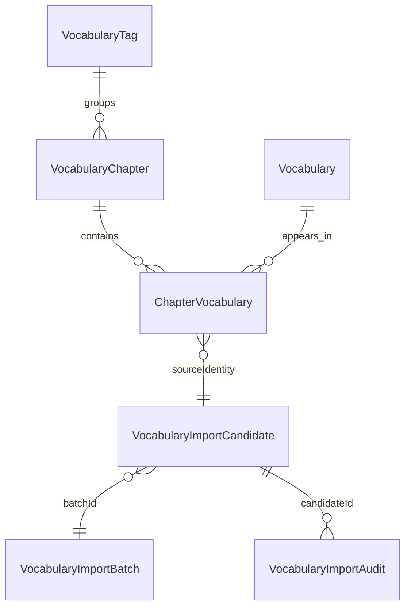
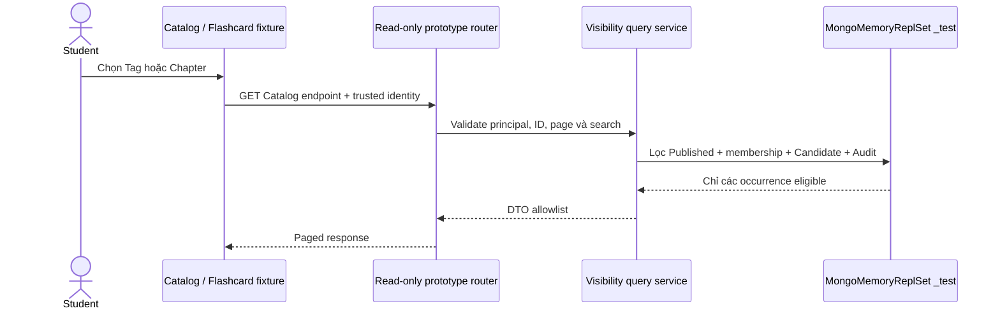

# Phase V4B — Student Vocabulary Catalog Architecture

## Trạng thái

Đây là prototype chạy trong fixture cô lập. Router Student không được mount trong `backend/src/app.js`; trang Catalog không được đăng ký vào `frontend/src/routes/AppRoutes.jsx`. Chính sách truy cập vẫn `PENDING_PO`.

## Mô hình dữ liệu

`Vocabulary` là nội dung Catalog-only. `ChapterVocabulary` biểu diễn một lần xuất hiện của Vocabulary trong Chapter và giữ `sortOrder`. Một Vocabulary có thể thuộc nhiều Chapter; mỗi membership phải có Candidate riêng đã được duyệt và Confirm Draft, nối bằng `sourceIdentity` và các ID nhập chính xác.

Student Catalog không tạo hoặc suy diễn `Lesson`, `Course` hay `LearningProgress`. Mỗi Chapter đã mở tạo đúng một card aggregate; từ vựng được tải theo Chapter khi card được mở.

## Luồng đọc

Student web E2E dùng fixture có `HashRouter` để kiểm tra browser history. Đây không phải route hoặc đăng nhập của ứng dụng thật. Backend harness tự khởi tạo MongoMemoryReplSet trên `127.0.0.1` với database kết thúc bằng `_test` và chỉ seed từ vựng tổng hợp.

## Quy tắc kiến trúc

- API là read-only; không có Publish, import, review hay progress write.
- Query backend xác minh Published ở Tag, Chapter và Catalog Vocabulary; Chapter phải trỏ tới đúng Tag.
- Membership phải nối đúng Chapter/Vocabulary và có provenance V3A còn nguyên.
- Candidate `REVIEW_APPROVED` phải có audit `REVIEW_DECISION/APPROVE` đúng Batch, source, reviewer; `CONFIRMED_DRAFT` audit phải khớp membership, Chapter và Vocabulary.
- UI không nhận HTML thực thi. Chuỗi được render như React text node; DTO không đưa locator/source metadata sang client.
- Catalog dùng bookmark localStorage riêng, không làm thay đổi khóa bookmark Lesson Flashcard.

## Cổng chưa mở

Không có application database baseline, quyền truy cập Student đã duyệt, application route, production publish, migration, import 711 từ hoặc triển khai production trong Phase V4B.
