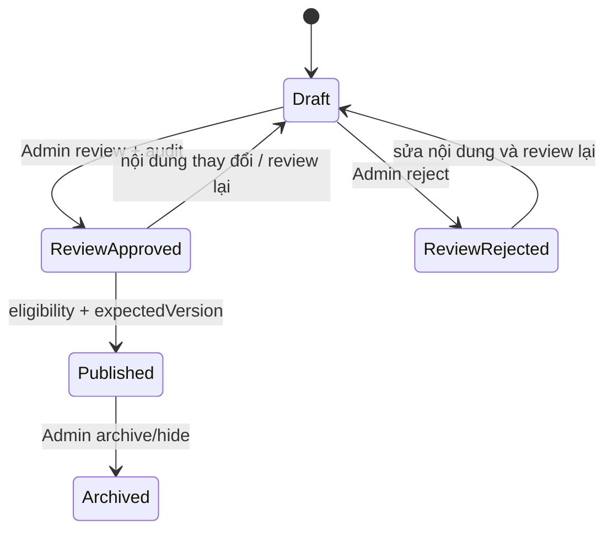

# Phase V5A — Publication Workflow Implementation

## Kết quả và ranh giới

Publication được triển khai thành prototype chạy qua các router/service riêng trong harness. `backend/src/app.js` không import hoặc mount các router prototype; Student và Admin routes của ứng dụng vẫn giữ nguyên. Service từ chối chạy ngoài MongoDB loopback có tên kết thúc bằng `_test`.

Các đối tượng được hỗ trợ:

- `VocabularyTag` và `VocabularyChapter` có lifecycle `draft → published → archived`.
- Catalog-only `Vocabulary` nằm trong collection Vocabulary dùng chung với legacy rows; `catalogOnly=true` phân biệt dữ liệu Catalog và `catalogStatus` quản lý Draft/Published/Archived.
- Editorial review là trục riêng, được ghi thành audit và so sánh version/content hash. Review Approved không tự xuất bản.

Review status thực tế được suy ra từ audit mới nhất, không phải từ status client gửi lên. Với Tag/Chapter, audit gắn `entityVersion` và content hash. Với Vocabulary import, Candidate lưu `reviewedVersion` và `reviewedContentHash`; edit sau review xóa bằng chứng snapshot.

## API trong harness

Prefix: `/admin/vocabulary-publication`.

| Method | Path | Mục đích |
|---|---|---|
| GET | `/eligibility/:entityType/:entityId?membershipId=…` | Eligibility và blockers |
| GET | `/tags/:tagId/summary` | Tag, Chapters, Vocabulary counts, blockers, Candidate detail refs và audit |
| GET | `/audit?entityType=…&entityId=…` | Publication/editorial audit đã phân trang |
| POST | `/tags/:tagId/review` | Review Tag |
| POST | `/chapters/:chapterId/review` | Review Chapter |
| POST | `/tags/:tagId/publish` | Publish Tag |
| POST | `/chapters/:chapterId/publish` | Publish Chapter sau parent Tag |
| POST | `/vocabularies/:vocabularyId/publish` | Publish Vocabulary cho đúng membership |
| POST | `/tags/:tagId/archive` | Archive Tag |
| POST | `/chapters/:chapterId/archive` | Archive Chapter |
| POST | `/vocabularies/:vocabularyId/hide` | Ẩn Catalog Vocabulary |

Mọi API yêu cầu middleware `authenticateAdmin` do harness inject, sau đó kiểm tra `req.user` có ObjectId và role Admin. Status không nằm trong payload allowlist. Transition yêu cầu `expectedVersion`; Publish/Archive/Hide còn yêu cầu `idempotencyKey`. Candidate Vocabulary cần `membershipId` tường minh.

## Tính nguyên tử và tương thích

Publication ghi trạng thái entity và `VocabularyPublicationAudit` trong cùng transaction trên replica set. Conditional update theo `_id + __v` serialize concurrent writes. Unique partial index trên `(entityType, entityId, idempotencyKey)` ngăn một key ghi lặp; retry cùng action, membership và trạng thái mới trả lại kết quả idempotent. Audit chứa actor, thời điểm, version trước/sau, hash và key.

Archive Tag/Chapter không cascade-delete Chapter, Vocabulary, Membership hoặc LearningProgress. Student query tự loại Chapter/Tag không Published và Vocabulary không đủ toàn bộ import evidence. Hide Vocabulary ghi trạng thái ẩn/archived, không xóa Vocabulary hoặc Membership.

Prototype không tạo index hay migration trên ứng dụng thật. Index chỉ được khởi tạo trong harness test.

## Kiểm chứng

- Backend: `npm run test:vocabulary-publication-v5a` — 9/9 PASS.
- Browser với backend và `MongoMemoryReplSet`: `npm run test:vocabulary-publication-v5a:real:e2e` — PASS, loopback database `vocabulary_publication_v5a_browser_test`.
- Production route registration: chưa thực hiện, đúng với `PENDING_PO`.
